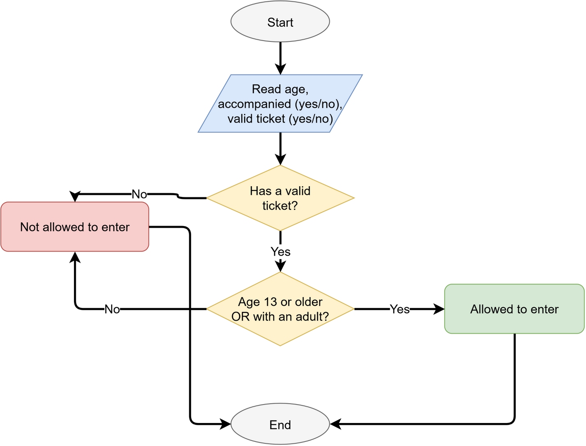

# Tutorial 1 - Week 2: Movie Theater Admission Logic

## Scenario

A movie theater has the following admission policy. A person is allowed to enter if:

- Users are 13 years old or older, OR
- Users are accompanied by an adult, AND
- Users must have a valid ticket.

## 1. Identify the Components

### 1.1 What are the inputs?

| Input | Type | Possible values |
|---|---|---|
| Age | whole number | any age, the check is age >= 13 |
| Accompanied by an adult | boolean | yes or no |
| Valid ticket | boolean | yes or no |

### 1.2 What is the process?

The program combines the three inputs into one boolean expression and evaluates it:

```
(age >= 13 OR accompanied by adult) AND valid ticket
```

The OR part checks whether the person may watch by age (old enough or with an adult). The AND part then applies the ticket condition, because a person is only allowed in with a valid ticket.

### 1.3 What is the output?

One of two messages:

- "Allowed to enter" when the whole expression is true
- "Not allowed to enter" when the whole expression is false

## 2. Design the Algorithm

### 2.1 Diagram



The draw.io source is saved as `admission_flowchart.drawio` in this folder.

### 2.2 Truth Table

Let A = age is 13 or older, B = accompanied by an adult, T = has a valid ticket.
The admission expression is (A OR B) AND T.

| A (age >= 13) | B (accompanied) | T (valid ticket) | A OR B | (A OR B) AND T | Admission |
|---|---|---|---|---|---|
| True | True | True | True | True | Allowed |
| True | True | False | True | False | Not allowed |
| True | False | True | True | True | Allowed |
| True | False | False | True | False | Not allowed |
| False | True | True | True | True | Allowed |
| False | True | False | True | False | Not allowed |
| False | False | True | False | False | Not allowed |
| False | False | False | False | False | Not allowed |

The table shows why the AND matters: even when A OR B is true, a missing ticket (T = False) always blocks entry. Admission only happens on rows 1, 3 and 5.

### 2.3 Algorithm (Step-by-Step Solution)

1. Start
2. Read the person's age
3. Ask whether the person is accompanied by an adult
4. Ask whether the person has a valid ticket
5. Compute A OR B, where A is "age is 13 or older" and B is "accompanied by an adult"
6. Combine the result of step 5 with the ticket condition using AND
7. If the final result is true, display "Allowed to enter"
8. Otherwise, display "Not allowed to enter"
9. End

### 2.4 Pseudocode

```
START
    READ age
    READ accompanied (yes/no)
    READ has_ticket (yes/no)

    IF (age >= 13 OR accompanied == yes) AND has_ticket == yes THEN
        PRINT "Allowed to enter"
    ELSE
        PRINT "Not allowed to enter"
    END IF
END
```

## 3. Evaluate Expression: Test with Input Samples

| # | Age | Accompanied | Valid ticket | (A OR B) AND T | Expected output |
|---|---|---|---|---|---|
| 1 | 15 | no | yes | True AND True | Allowed to enter |
| 2 | 10 | yes | yes | True AND True | Allowed to enter |
| 3 | 13 | no | yes | True AND True | Allowed to enter (boundary: exactly 13) |
| 4 | 10 | no | yes | False AND True | Not allowed to enter |
| 5 | 15 | yes | no | True AND False | Not allowed to enter (no ticket) |
| 6 | 10 | yes | no | True AND False | Not allowed to enter (no ticket) |

Samples 1 to 3 confirm the OR part works, including the age 13 boundary. Samples 4 to 6 confirm that the ticket condition blocks entry whenever it is missing.

## 4. Update Files Using Git and Push

The files in this folder were added to the python repository and pushed with:

```
git init
git status
git add w2_tutorial.md admission_flowchart.drawio admission_flowchart.png
git commit -m "Add tutorial 1 admission logic notes"
git push
```
